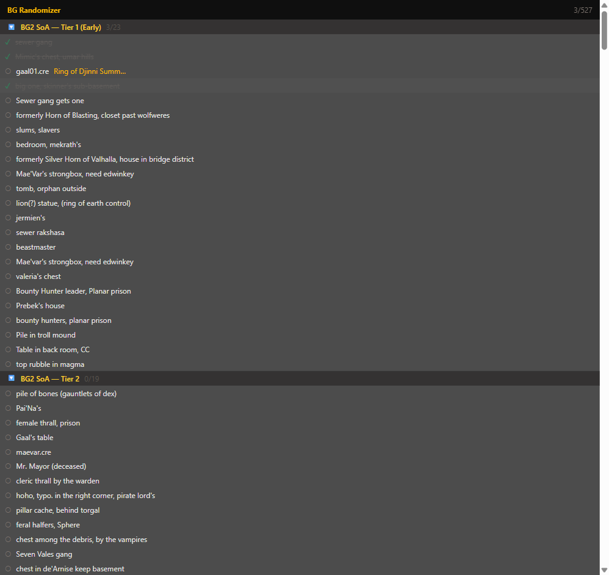

# BG Item Randomizer Dashboard

A web tracker and always-on-top transparent Electron overlay for **[Fredrik Lindgren (Wisp)'s Baldur's Gate Item Randomiser](https://github.com/FredrikLindgren/bgee-itemrandomiser)** and **[Chriz Item Randomiser](https://github.com/Chrizhermann/chriz-item-randomiser)**.

**[More on bg.chrizfader.org/randomiser](https://bg.chrizfader.org/randomiser)** · **[Latest Download (v0.2.0-alpha)](../../releases/latest)**

---

## Part 1: For Players & Streamers


### Download (Alpha)

Grab the latest build from the **[Releases page](../../releases/latest)**:

| Platform | File | Notes |
| --- | --- | --- |
| Windows | `BG-Randomizer-0.2.0-alpha.exe` | Portable, no install. SmartScreen may warn — choose **Run anyway**. |
| macOS | `BG-Randomizer-0.2.0-alpha.dmg` | Untested. Right-click → Open to bypass Gatekeeper. |
| Linux | `BG-Randomizer-0.2.0-alpha.AppImage` | Untested. `chmod +x` then run. |

macOS and Linux artifacts are built by CI and have **not been tested by the maintainer** — please [open an issue](../../issues) if something breaks.

### Features

- Track every randomized item location across BG1 and BG2
- Group locations by tier, area, or completion status
- Multi-session support — track multiple playthroughs side by side
- Notes, party-member assignment, item-code toggle, and search by item name or code

### Overlay Mode (`F9`)



- Launch the desktop app to open an always-on-top transparent window while playing or streaming
- Press **`F9`** to toggle overlay visibility
- Click the **`IR`** badge to expand or collapse the checklist, or **drag the badge** to reposition it anywhere on screen
- Progress syncs with the web view via `localStorage`

---

## Part 2: Status, For Developers & License

### Alpha Status

- `localStorage` data shape may change between alpha releases (existing session data can reset)
- macOS and Linux builds are CI-produced and untested
- No auto-updater yet — download the latest build from Releases when updating

### For Developers

```bash
git clone https://github.com/Chrizhermann/bg-item-randomizer-dashboard.git
cd bg-item-randomizer-dashboard
npm install

npm run dev              # start web app + Electron overlay
npm run build            # TypeScript check + Vite production build
npm run package          # build Windows portable .exe locally
npm run extract-data     # regenerate JSON data from game + mod files
```

See [CLAUDE.md](CLAUDE.md) for architecture notes and `BG_GAME_DIR` details.

### Credits

- Original Item Randomiser mod: [Fredrik Lindgren (Wisp)](https://github.com/FredrikLindgren/bgee-itemrandomiser)
- Dashboard & Electron overlay: Christopher Hermann

## License

Licensed under the [MIT License](LICENSE).
