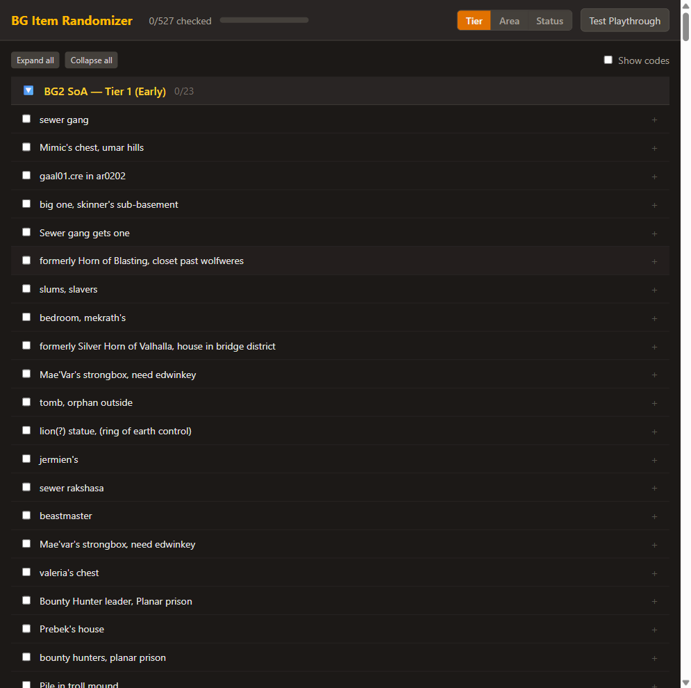

# BG Item Randomizer Dashboard

Tracker for [Fredrik Lindgren's Baldur's Gate 1/2 Item Randomiser mod](https://github.com/FredrikLindgren/bgee-itemrandomiser). A web app and a transparent Electron overlay you can keep on top while you play.



## Download (alpha)

Grab the latest build from the [**Releases page**](../../releases/latest):

| Platform | File | Notes |
|----------|------|-------|
| Windows  | `BG-Randomizer-0.2.0-alpha.exe`       | Portable, no install. SmartScreen may warn — choose "Run anyway". |
| macOS    | `BG-Randomizer-0.2.0-alpha.dmg`       | Untested. Right-click → Open to bypass Gatekeeper. |
| Linux    | `BG-Randomizer-0.2.0-alpha.AppImage`  | Untested. `chmod +x` then run. |

macOS and Linux builds are produced by CI but have **not been tested by the maintainer** — please [open an issue](../../issues) if something breaks.

## Features

- Track every randomized item across BG1 and BG2
- Group locations by tier, area, or completion status
- Session support — run multiple playthroughs side-by-side
- Notes, party-member assignment, and item-code display
- Search by item name or code

## Overlay mode (for streamers & players)


- Launch the desktop app — it opens an always-on-top transparent window
- Press **F9** to toggle visibility
- Click the **IR** badge to expand the checklist, click again to collapse
- **Drag the IR badge** to reposition the overlay anywhere on screen
- State syncs with the web app via localStorage

## Status

Alpha. Things change fast:
- localStorage format may change between releases (your session data could wipe)
- macOS and Linux builds are built but not tested
- No auto-update yet — re-download when you want the latest

## For developers

```bash
git clone https://github.com/Chrizhermann/bg-item-randomizer-dashboard
cd bg-item-randomizer-dashboard
npm install

npm run dev              # start web app + Electron overlay
npm run build            # production build
npm run package          # build Windows .exe locally
npm run extract-data     # regenerate data from game files (needs BG install)
```

See [`CLAUDE.md`](CLAUDE.md) for architecture notes.

## Credits

- Original mod: [Fredrik Lindgren](https://github.com/FredrikLindgren) — Baldur's Gate Item Randomiser
- Dashboard: Christopher Hermann
